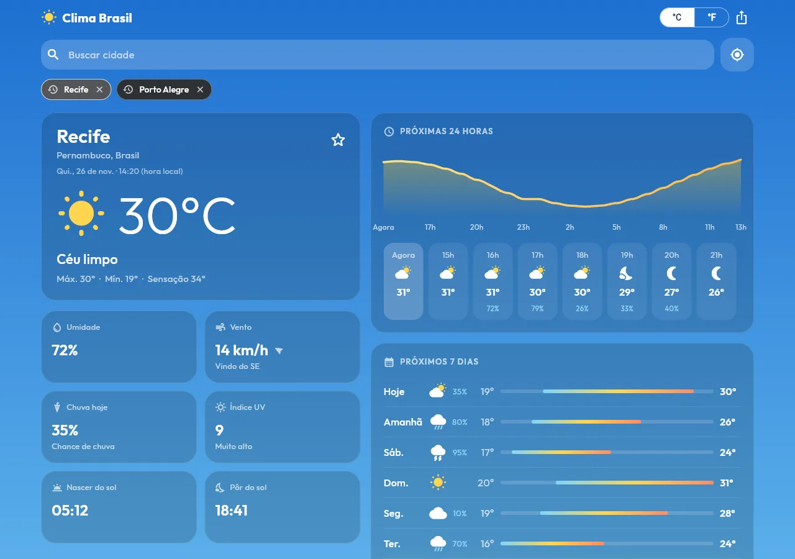
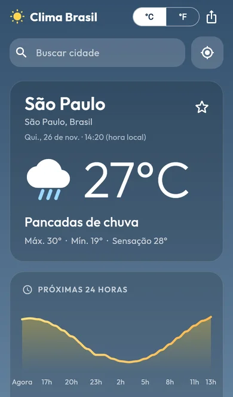
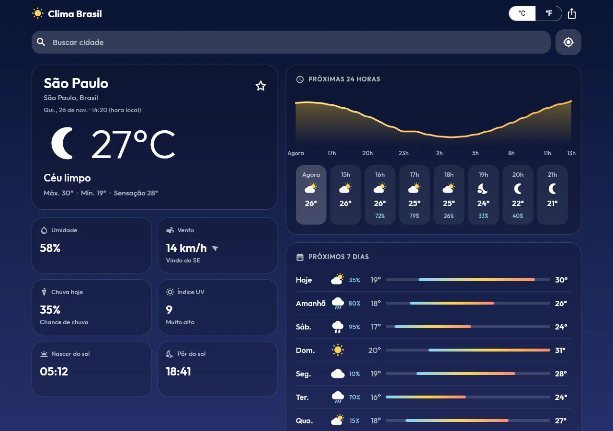

<h1 align="center">Clima Brasil</h1>

<h3 align="center">
  <a href="https://biabruna19.github.io/App-Metereologico/">Abrir o app → biabruna19.github.io/App-Metereologico</a>
</h3>

<p align="center">
  
  
</p>

## Sobre

App de previsão do tempo feito em Flutter. Você busca uma cidade (ou usa a sua localização) e vê como está o tempo agora, as próximas 24 horas e os próximos 7 dias. O fundo muda de cor conforme o céu e o horário da cidade: azul em dia de sol, cinza quando está nublado e escuro à noite.

## O que dá para fazer

- **Buscar qualquer cidade**, com sugestões aparecendo enquanto você digita.
- **Usar a localização** do celular ou do navegador.
- **Ver o tempo agora**: temperatura, sensação térmica, máxima e mínima do dia e a descrição do céu.
- **Detalhes**: umidade, vento com direção, chance de chuva, índice UV, nascer e pôr do sol.
- **Próximas 24 horas** num gráfico (dá para tocar para ver cada hora) e numa faixa com ícone e chance de chuva.
- **Próximos 7 dias**, com uma barra que mostra a faixa de temperatura de cada dia.
- **Favoritos e buscas recentes** salvos no aparelho. O app abre na última cidade que você viu.
- **°C ou °F** e **compartilhar** a previsão.
- O horário mostrado é sempre o da cidade, então funciona para cidades de outros fusos também.

<p align="center">
  
</p>

## Tecnologias

- **Flutter** e **Dart**, com o pacote **material_ui**
- **Provider** para o estado do app
- **Open-Meteo** para a previsão e a busca de cidades (gratuita e sem chave)
- **fl_chart** no gráfico das próximas horas
- **shared_preferences** para guardar favoritos, recentes e preferências
- **geolocator** para a localização
- **GitHub Actions** roda a análise e os testes e publica a versão web no GitHub Pages a cada mudança

Na primeira versão o histórico de buscas ia para o Supabase, mas ele nunca aparecia na tela e parava de funcionar quando o projeto gratuito era pausado. Agora tudo fica no próprio aparelho, sem precisar de servidor.

## Rodando no computador

Precisa do [Flutter](https://docs.flutter.dev/get-started/install) 3.47 ou mais novo.

```bash
git clone https://github.com/biabruna19/App-Metereologico.git
cd App-Metereologico
flutter pub get
flutter run -d chrome
```

Para rodar os testes:

```bash
flutter test
```

## Organização

```
lib/
  main.dart             tema e início do app
  models/               cidade e previsão (leitura do JSON da Open-Meteo)
  services/             API, armazenamento no aparelho e localização
  providers/            estado do app (busca, favoritos, unidade…)
  screens/              tela principal
  widgets/              cartões: tempo atual, detalhes, 24 horas, 7 dias
  util/                 descrições e ícones do tempo, formatação
test/                   testes dos modelos, do estado e da tela
```

## Desenvolvido por

**Beatriz Oliveira**<br>
[GitHub](https://github.com/biabruna19) · [LinkedIn](https://www.linkedin.com/in/beatriz-oliveira-759867294/) · [E-mail](mailto:biabruna.1901@gmail.com)

Dados meteorológicos: [Open-Meteo](https://open-meteo.com/) · Fonte: Outfit (SIL Open Font License)
